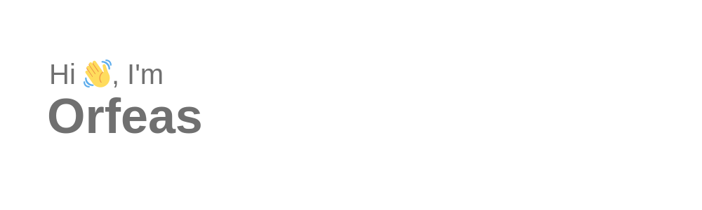

- 🔭 I'm working at Thought Machine as a Backend Engineer, on our cloud-native core banking platform building Internal Applications
- 🎄 Every December I enjoy trying to solve the [Advent of Code](https://adventofcode.com/) challenges. You can find my solutions here:
  - [2022 in Python](https://github.com/orfeasa/advent-of-code-2022)
  - [2021 in Python](https://github.com/orfeasa/advent-of-code-2021)
  - [2020 in Go](https://github.com/orfeasa/advent-of-code-2020) 

<!--
**orfeasa/orfeasa** is a ✨ _special_ ✨ repository because its `README.md` (this file) appears on your GitHub profile.

Here are some ideas to get you started:

- 🔭 I’m currently working on ...
- 🌱 I’m currently learning ...
- 👯 I’m looking to collaborate on ...
- 🤔 I’m looking for help with ...
- 💬 Ask me about ...
- 📫 How to reach me: ...
- 😄 Pronouns: ...
- ⚡ Fun fact: ...
-->
